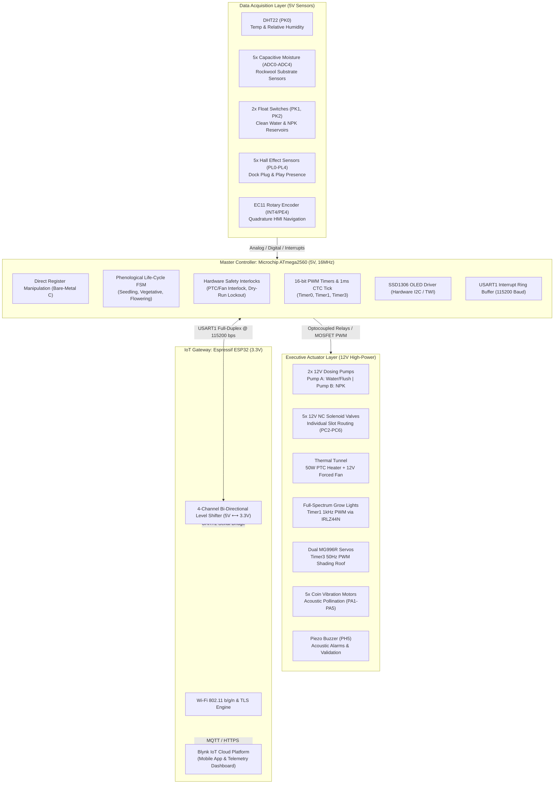
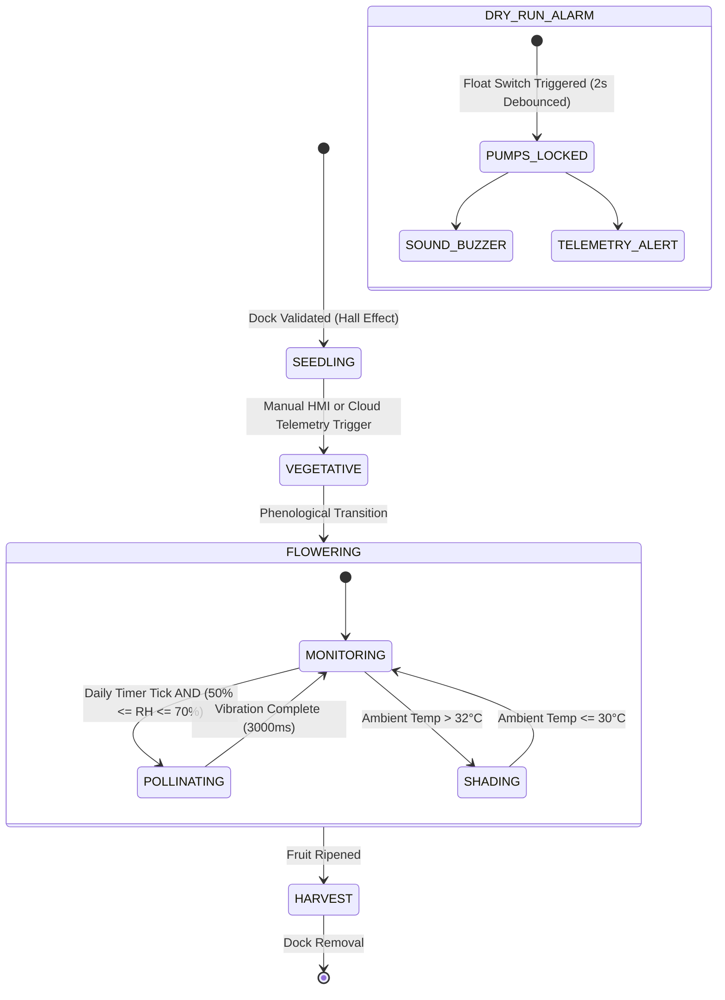

# C.A.M.P.I. - Controlul Automat și Monitorizarea Plantelor de Interior
### Precision Smart Farming Platform for Hydroponic Dwarf Tomatoes (*Solanum lycopersicum* cv. *Micro Tom*)

[](#hardware-architecture)
[](https://www.microchip.com/en-us/product/ATmega2560)
[-green.svg?style=for-the-badge&logo=espressif)](https://blynk.io/)
[-orange.svg?style=for-the-badge)](#software-stack--toolchain)
[](#software-stack--toolchain)
[-black.svg?style=for-the-badge)](#software-stack--toolchain)

---

## 1. Project Overview

**C.A.M.P.I.** (*Controlul Automat și Monitorizarea Plantelor de Interior* / Automated Control and Monitoring of Indoor Plants) is an industrial-grade, precision smart farming embedded platform specifically engineered for the automated hydroponic cultivation of dwarf tomatoes (*Solanum lycopersicum* cv. *Micro Tom*).

Traditional soil-based indoor cultivation suffers from inconsistent water retention, soil-borne pathogen risks, inaccurate nutrient dosing, and manual labor overhead. C.A.M.P.I. addresses these challenges by implementing an automated **closed-loop hydroponic micro-farming system** with:

* **Inert Substrate Optimization**: Complete replacement of soil with agricultural mineral wool (**Rockwool**), guaranteeing a sterile root zone, high aeration porosity (~90%), and precise moisture control without soil compaction.
* **Modular Plug & Play Docking**: Five independent 10x10 cm PETG 3D-printed plant docks mounted on an extruded 20x20 mm aluminum frame (V-Slot/T-Slot). Docks feature Neodymium magnetic self-alignment, quick-disconnect fluid couplings with check valves, and spring-loaded electrical contacts.
* **Time-Proportional Fluid Dosing**: Dynamic multi-component nutrient mixing directly in the substrate manifold, eliminating the need for expensive peristaltic pumps by pairing dual 12V high-flow pumps with millisecond-accurate timer windows.
* **Microclimate & Bio-Vibration Engineering**: Integrated active thermal conditioning (50W PTC ceramic heater with safety-interlocked forced-air convection), dual-servo thermal canopy shading, and automated acoustic buzz pollination.

---

## 2. Hardware Architecture

C.A.M.P.I. utilizes a decoupled **Master-Gateway** architecture that separates deterministic, hard real-time safety critical control from asynchronous wireless cloud communications.



### Master Controller: Microchip ATmega2560 (16MHz, 5V Native)
* **Dedicated Real-Time Domain**: Runs 100% bare-metal C without an RTOS or Arduino runtime. Handles microsecond-accurate 1-Wire bit-banging, hardware PWM generation, and atomic state transitions.
* **5V Native Precision ADC**: Features an onboard 16-channel, 10-bit Successive Approximation ADC. Operating natively at 5V ensures high signal-to-noise ratio (SNR) and full dynamic range ($4.88\,\text{mV/LSB}$) without active level scaling on analog moisture probes.
* **Local Autonomous Failsafe**: In the event of Wi-Fi loss, gateway disconnect, or cloud downtime, the ATmega2560 maintains autonomous operation, safety interlocks, and local HMI navigation.

### IoT Gateway: Espressif ESP32 (3.3V Domain)
* **Network & Cloud Offloading**: Offloads TCP/IP networking, WPA2/WPA3 Wi-Fi management, TLS handshakes, and Blynk IoT API translation from the real-time core.
* **Galvanic & Voltage Decoupling**: Communicates with the ATmega2560 USART1 via a 4-channel bi-directional MOSFET level shifter ($5\,\text{V} \longleftrightarrow 3.3\,\text{V}$). Isolates the master MCU from wireless transmission current spikes.

---

## 3. Software Stack & Toolchain

The firmware is designed in strict accordance with embedded systems safety standards and high-reliability C practices.

* **Language Standard**: ISO C99 (`-std=c99`), strictly typed (`<stdint.h>`, `<stdbool.h>`).
* **Toolchain**: AVR-GCC (`avr-gcc` 5.4.0+ / 7.3.0+) targeting the `atmega2560` architecture.
* **Build System**: GNU Make with modular source inclusion and automatic firmware footprint inspection via `avr-size`.
* **Hardware Programming**: `avrdude` over `wiring` (STK500v2 protocol) at 115200 baud.
* **Direct Register Manipulation**: **Zero Arduino IDE abstractions, zero third-party libraries, and zero blocking delay loops in the main execution cycle.**
  * Direct port configuration using `DDRx`, `PORTx`, `PINx`.
  * Direct timer manipulation using `TCCRxA`, `TCCRxB`, `TCNTx`, `OCRxA`, `ICRx`.
  * Direct ADC conversion control via `ADMUX`, `ADCSRA`, `ADCSRB`.
  * Direct hardware interrupt configuration via `EICRA`, `EICRB`, `EIMSK`.
  * Direct hardware I2C (Two-Wire Interface) via `TWBR`, `TWSR`, `TWDR`, `TWCR`.
  * Direct USART control via `UBRR1H/L`, `UCSR1A`, `UCSR1B`, `UCSR1C`.

### Firmware Memory Utilization (Release Build)
```text
Program (Flash):  12,534 bytes  (4.8% of 256 KB)
Data    (SRAM):      598 bytes  (7.3% of 8 KB)
EEPROM  (Config):     16 bytes  (0.4% of 4 KB)
```

---

## 4. Bill of Materials (BOM)

| Subsystem | Item / Component | Qty | Operating Voltage | Interface / Pinout | Functional Description |
| :--- | :--- | :---: | :---: | :---: | :--- |
| **Compute** | Microchip ATmega2560 Dev Board | 1 | 5V DC | Master MCU | Real-time executive controller, FSM, ADC acquisition, PWM generation. |
| **Compute** | Espressif ESP32 NodeMCU / WROOM-32 | 1 | 3.3V DC | IoT Gateway | Wi-Fi 802.11b/g/n, telemetry bridge to Blynk Cloud. |
| **Interface** | 4-Channel Bi-Directional Level Shifter | 1 | 5V ⟷ 3.3V | I/O Level Matching | Safe USART1 UART bridge between ATmega2560 (5V) and ESP32 (3.3V). |
| **Sensors** | Capacitive Soil Moisture Sensor v2.0 | 5 | 5V DC | Analog (ADC0 - ADC4) | Corrosion-resistant analog moisture probes calibrated for Rockwool. |
| **Sensors** | DHT22 / AM2302 Sensor | 1-2 | 5V DC | 1-Wire Digital (PK0 / PA0) | Precision microclimate air temperature & relative humidity ($RH$). |
| **Sensors** | Hall Effect Sensor (SS49E / A3144) | 5 | 5V DC | Digital Input (PL0 - PL4) | Magnetic dock presence detection for modular 10x10 cm plant slots. |
| **Sensors** | Side-Mount Magnetic Float Switch | 2 | 5V (Pull-Up) | Digital Input (PK1, PK2) | Reservoir level safety (Clean Water Tank & NPK Concentrate Tank). |
| **Actuators** | 12V DC Dosing Pumps (Submersible) | 2 | 12V DC | Digital Out (PC0, PC1 via Relay) | Pump A: Clean Water / Flush; Pump B: NPK Fertilizer Concentrate. |
| **Actuators** | 12V DC Normally Closed Solenoid Valve | 5 | 12V DC | Digital Out (PC2 - PC6 via Relay) | Independent slot fluid routing manifolds. |
| **Actuators** | MG996R High-Torque Metal Gear Servos | 2 | 5V - 6V DC | 16-bit PWM (PE3/OC3A, PE4/OC3B) | Dual-axis automated shading roof canopy (50Hz / 20ms pulse). |
| **Actuators** | Coin Haptic Vibration Micro-Motors | 5 | 5V DC | Digital Out (PA1 - PA5 via Transistor) | Automated acoustic buzz pollination for tomato blossoms. |
| **Actuators** | 50W 12V PTC Ceramic Heating Element | 1 | 12V DC (4.2A) | Digital Out (PC7 via Relay) | Forced-convection thermal climate heating tunnel. |
| **Actuators** | 12V Brushless DC PC Fan (80mm/120mm) | 1 | 12V DC | Digital Out (PB4 via MOSFET/Relay) | Thermal airflow distribution & residual heat dissipation. |
| **Lighting** | Full-Spectrum LED Grow Light Strips | N/A | 12V DC | Timer1 PWM (PB5 / OC1A) | Photosynthetic active radiation (PAR) dimming via IRLZ44N MOSFET. |
| **Power** | 12V 20A Industrial Switching Power Supply | 1 | 230V AC ➔ 12V DC | Main DC Bus | Primary power supply for thermal elements, pumps, valves, and LEDs. |
| **Power** | Step-Down Buck Converter (LM2596/MP1584) | 1 | 12V ➔ 5.0V DC | Logic Power Bus | Regulated 5.0V rail for ATmega2560, sensors, and servos. |
| **Power** | 8-Channel 5V Optocoupled Relay Module | 1 | 5V Logic / 12V Coil | Digital I/O | Galvanic isolation for inductive pumps, valves, and PTC heater. |
| **Power** | IRLZ44N Logic-Level N-MOSFETs | 3 | 5V Gate Logic | PWM Driver | Fast switching for Grow Lights (1kHz) and Fan speed control. |
| **Protection**| 1N4007 Flyback Diodes | 7+ | 1000V 1A | Antiparallel Inductive Clamping | Suppression of inductive back-EMF spikes across pumps and solenoids. |
| **HMI** | SSD1306 0.96" 128x64 OLED Display | 1 | 5V DC | Hardware I2C / TWI (PD0, PD1) | Local dashboard: microclimate, dock status, reservoir levels, moisture bar. |
| **HMI** | EC11 Rotary Encoder with Pushbutton | 1 | 5V (Pull-Up) | External Interrupt (INT4/PE4, PE5, PH4) | Quadrature menu navigation and growth stage configuration. |
| **HMI** | Active Piezo Buzzer | 1 | 5V DC | Digital Out (PH5) | Acoustic feedback for dock insertion and dry-run alarm sirens. |
| **Backup** | 5V Mini Solar Panels + TP4056 + 18650 | 1 | 3.7V - 5V DC | Battery Backup | Solar harvesting & auxiliary backup for controller RTC/sensors. |

---

## 5. Hardware Pinout & Register Mapping

| ATmega2560 Pin | MCU Port / Bit | Direction | Driver Module | Target Component / Periphery |
| :--- | :---: | :---: | :--- | :--- |
| **Pin 18** | `PD3` (TXD1) | Output | `drivers/usart` | USART1 Transmit to ESP32 Gateway (via Level Shifter) |
| **Pin 19** | `PD2` (RXD1) | Input (ISR) | `drivers/usart` | USART1 Receive from ESP32 Gateway (128-byte Ring Buffer) |
| **Pin 20** | `PD1` (SDA) | In / Out | `drivers/i2c`, `ssd1306` | Hardware TWI (I2C) Data Line for SSD1306 OLED (0x3C) |
| **Pin 21** | `PD0` (SCL) | Output | `drivers/i2c`, `ssd1306` | Hardware TWI (I2C) Clock Line (100kHz / 400kHz) |
| **Pin 2** | `PE4` (INT4/OC3B) | In (EXT INT) / Out | `drivers/encoder`, `servo_roof` | Encoder Channel A (INT4) / Servo Roof 2 (Timer3 OC3B) |
| **Pin 3** | `PE5` | Input (Pull-up) | `drivers/encoder` | Encoder Channel B (Quadrature Phase) |
| **Pin 7** | `PH4` | Input (Pull-up) | `drivers/encoder` | Encoder Pushbutton (Menu Stage Select) |
| **Pin 5** | `PE3` (OC3A) | Output (PWM) | `drivers/servo_roof` | Servo Roof 1 (Timer3 16-bit Fast PWM @ 50Hz) |
| **Pin 11** | `PB5` (OC1A) | Output (PWM) | `drivers/grow_lights` | Full-Spectrum LED Grow Lights (Timer1 16-bit PWM @ 1kHz) |
| **Pin 8** | `PH5` | Output | `drivers/buzzer` | Active Piezo Buzzer (Chirp feedback & Alarms) |
| **Pin 10** | `PB4` | Output | `drivers/climate_control` | 12V Forced-Air Convection Fan Relay / MOSFET |
| **Pin 22** | `PA0` | In / Out | `drivers/dht22` | DHT22 Digital Temperature & Humidity Sensor (1-Wire) |
| **Pin 23 - 27** | `PA1` - `PA5` | Output | `drivers/pollinator` | 5x Coin Haptic Vibration Motors (Acoustic Pollination) |
| **Pin 37** | `PC0` | Output | `drivers/pumps` | Pump A Relay (Clean Water & Manifold Flush) |
| **Pin 36** | `PC1` | Output | `drivers/pumps` | Pump B Relay (NPK Fertilizer Concentrate) |
| **Pin 35 - 31** | `PC2` - `PC6` | Output | `drivers/valves` | 5x Solenoid Valves (Slot 1 to 5 Distribution) |
| **Pin 30** | `PC7` | Output | `drivers/climate_control` | 50W PTC Ceramic Heating Element Relay |
| **Pin 38** | `PD7` (or `PK1`) | Input (Pull-up) | `drivers/float_switch` | Float Switch: Clean Water Reservoir |
| **Pin 39** | `PG2` (or `PK2`) | Input (Pull-up) | `drivers/float_switch` | Float Switch: Nutrient NPK Reservoir |
| **Pin 49 - 45** | `PL0` - `PL4` | Input (Pull-up) | `drivers/dock_sensor` | 5x Magnetic Hall Effect Sensors (Docks 1 to 5) |
| **A0 - A4** | `PF0` - `PF4` | Analog Input | `drivers/moisture` | 5x Capacitive Moisture Sensors (ADC Channels 0 - 4) |

---

## 6. Core Logic, Finite State Machine (FSM) & Safety Interlocks

### 6.1. Plant Phenological Life-Cycle FSM
C.A.M.P.I. dynamically adjusts its environmental setpoints, lighting photoperiod, moisture triggers, and nutrient ratios based on the plant's growth stage:

| Phenological Stage | Soil Moisture Threshold (ADC) | Grow Light Intensity (PWM) | Dosing Ratio (Pump A : Pump B) | Automated Pollination | Thermal Target Band |
| :--- | :---: | :---: | :---: | :---: | :---: |
| **1. Seedling (*Răsad*)** | **60%** (Saturated Rockwool) | **50%** (Gentle PAR) | 90% Clean Water / 10% NPK | Disabled | 22.0°C - 24.5°C |
| **2. Vegetative Growth** | **50%** (Balanced Moisture) | **80%** (High PAR) | 60% Clean Water / 40% NPK | Disabled | 22.0°C - 25.0°C |
| **3. Flowering & Fruiting** | **40%** (Controlled Water Stress) | **100%** (Max PAR) | 30% Clean Water / 70% NPK (High K) | **Active** (50% $\le RH \le$ 70%) | 22.0°C - 25.0°C |



### 6.2. Safety Interlocks & Hardware Protection Rules

#### 1. Thermal Safety Interlock (PTC & Fan Forced Air)
* **Fire Hazard Prevention**: The 50W PTC ceramic element must never run in stagnant air.
* **Pre-Run Airflow Inertia**: The 12V fan is energized **100 ms prior** to the PTC relay.
* **Hysteresis Band**: Heating engages at $T \le 22.0^\circ\text{C}$ and disengages at $T \ge 25.0^\circ\text{C}$.
* **Post-Shutdown Cooldown**: When the PTC relay is cut, the fan continues forced convection for **15 seconds** to dissipate residual thermal energy and prevent chassis warping.

#### 2. Dual-Reservoir Anti-Wave Dry-Run Protection
* Both Clean Water and NPK reservoirs are equipped with magnetic float switches wired to internal pull-up inputs.
* **Anti-Wave Software Filter**: Reads are passed through a non-blocking **2-second software debounce** to ignore mechanical sloshing and fluid ripples.
* **Hardware Lockout**: If either reservoir is confirmed empty, hydraulic pumps are locked out immediately at the driver level, and an intermittent acoustic buzzer alarm is sounded.

#### 3. Controlled Acoustic Buzz Pollination Gating
* Tomato blossoms are self-fertile but require high-frequency vibration (~300–400 Hz sonication) to release pollen from the anthers.
* **Hygrometric Window Gate**: Daily haptic motor vibrations are strictly permitted **only when relative humidity ($RH$) is between 50% and 70%**:
  * If $RH > 70\%$, pollen grains clump due to moisture, rendering vibration ineffective.
  * If $RH < 50\%$, pollen desiccation occurs, inhibiting fertilization.

#### 4. Automatic Thermal Shading Canopy
* If microclimate temperature exceeds **32.0°C**, dual MG996R servos rotate the shading canopy to protect tomato blossoms from heat-induced pollen sterility.

#### 5. Plug & Play Dock Insertion Debounce
* Modular 10x10 cm pots are detected via Hall effect magnetic proximity sensors.
* A mandatory **5-second continuous presence validation** is enforced before the slot's irrigation valve is unlocked, followed by an acoustic confirmation beep.

---

## 7. Directory Structure

```text
C.A.M.P.I./
├── Makefile                        # Multi-target AVR-GCC build automation
├── README.md                       # Comprehensive technical documentation
├── drivers/                        # Hardware Abstraction Layer (HAL)
│   ├── adc/                        # 10-bit Successive Approximation ADC (16 channels)
│   ├── buzzer/                     # Acoustic feedback & alarm frequency toggling
│   ├── climate_control/            # Safety interlocked PTC heater & fan hysteresis
│   ├── dht22/                      # Custom 1-Wire bit-banged microclimate driver
│   ├── dock_sensor/                # Magnetic Hall effect sensors & 5s insertion validation
│   ├── eeprom/                     # Non-volatile phenological stage persistence
│   ├── encoder/                    # EC11 Rotary Encoder external interrupt (INT4) decoder
│   ├── float_switch/               # 2-second debounced dual reservoir dry-run monitor
│   ├── gpio/                       # General Purpose I/O register manipulation (PORTA-PORTL)
│   ├── grow_lights/                # Timer1 16-bit PWM dimming driver (1 kHz)
│   ├── i2c/                        # Hardware Two-Wire Interface (TWI) Master driver
│   ├── moisture/                   # 5-slot Rockwool-calibrated capacitive ADC routines
│   ├── pollinator/                 # Haptic coin vibration motors & humidity gating
│   ├── pumps/                      # Time-proportional dosing pumps (Clean Water & NPK)
│   ├── servo_roof/                 # Timer3 16-bit PWM driver for dual MG996R servos (50 Hz)
│   ├── ssd1306/                    # 128x64 OLED graphics & embedded 5x7 ASCII font engine
│   ├── timer/                      # Timer0 1ms CTC System Tick & Millis() timekeeper
│   ├── usart/                      # USART1 ISR-driven non-blocking 128-byte ring buffer
│   └── valves/                     # 5-channel solenoid distribution valve controller
├── src/
│   └── main.c                      # Deterministic non-blocking superloop executive
└── utils/
    └── bit_macros.h                # High-speed inline bitwise manipulation macros
```

---

## 8. Build, Flash & Deployment

### Prerequisites
Install the AVR toolchain and programmer utilities:
```bash
sudo apt-get update
sudo apt-get install -y gcc-avr binutils-avr avr-libc avrdude make
```

### Compilation
To compile the entire bare-metal firmware and view flash/RAM footprint:
```bash
make clean
make all
```

Expected compilation output:
```text
Compiling src/main.c ...
Compiling drivers/gpio/gpio.c ...
Compiling drivers/adc/adc.c ...
Compiling drivers/timer/timer.c ...
Compiling drivers/usart/usart.c ...
Compiling drivers/dht22/dht22.c ...
Compiling drivers/moisture/moisture.c ...
Compiling drivers/float_switch/float_switch.c ...
Compiling drivers/dock_sensor/dock_sensor.c ...
Compiling drivers/pumps/pumps.c ...
Compiling drivers/valves/valves.c ...
Compiling drivers/climate_control/climate_control.c ...
Compiling drivers/grow_lights/grow_lights.c ...
Compiling drivers/servo_roof/servo_roof.c ...
Compiling drivers/pollinator/pollinator.c ...
Compiling drivers/i2c/i2c.c ...
Compiling drivers/ssd1306/ssd1306.c ...
Compiling drivers/encoder/encoder.c ...
Compiling drivers/buzzer/buzzer.c ...
Compiling drivers/eeprom/eeprom.c ...
Linking build/firmware.elf ...
Generating build/firmware.hex ...

=== Firmware Memory Footprint ===
Program:   12534 bytes (4.8% Full)
Data:        598 bytes (7.3% Full)
================================
```

### Flashing to ATmega2560
Connect the ATmega2560 via USB and verify the device node (typically `/dev/ttyACM0` or `/dev/ttyUSB0`):
```bash
# Flash the Intel HEX file via avrdude STK500v2 (Wiring protocol)
make flash PORT=/dev/ttyACM0
```

---

## 9. Author & License

* **Project Title**: C.A.M.P.I. (*Controlul Automat și Monitorizarea Plantelor de Interior*)
* **Author**: Frumosu Rafael Mihai
* **Contact**: [rafaelfrumosu42@gmail.com](mailto:rafaelfrumosu42@gmail.com)
* **Target Application**: Bachelor's Thesis - Precision Hydroponic Smart Farming Systems
